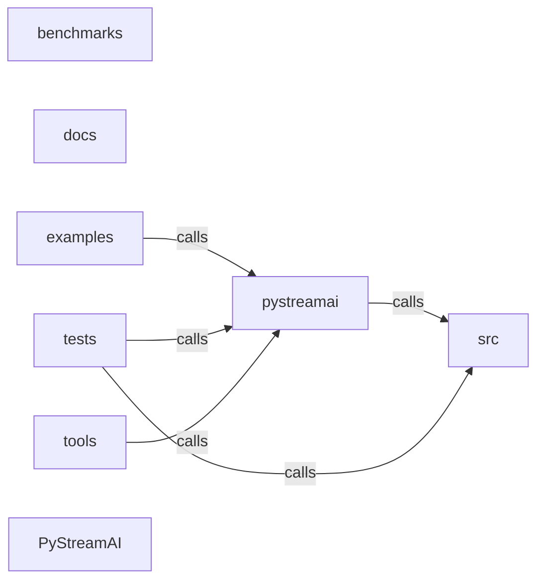

_Generated by CodeAtlas._

## Details

Architecture map of PyStreamAI.

### benchmarks

Owns 34 symbols across 7 file(s).

**Related Classes/Methods:** _None_

**Source Files:**

- `benchmarks/bench_bert_llm.py`
  - `benchmarks.bench_bert_llm.benchmark_bert`
  - `benchmarks.bench_bert_llm.benchmark_gpt2`
- `benchmarks/bench_oss_comparison.py`
  - `benchmarks.bench_oss_comparison.benchmark_onnx_runtime`
  - `benchmarks.bench_oss_comparison.benchmark_pystreamai_optimizations`
  - `benchmarks.bench_oss_comparison.benchmark_pytorch_baseline`
  - `benchmarks.bench_oss_comparison.benchmark_summary`
- `benchmarks/inference.py`
  - `benchmarks.inference.InferenceOptimizer`
  - `benchmarks.inference.InferenceOptimizer.__init__`
  - `benchmarks.inference.InferenceOptimizer.infer_baseline`
  - `benchmarks.inference.InferenceOptimizer.infer_batched`
  - `benchmarks.inference.InferenceOptimizer.infer_combined`
  - `benchmarks.inference.InferenceOptimizer.infer_kv_cached`
  - `benchmarks.inference.InferenceOptimizer.infer_quantized`
  - `benchmarks.inference.InferenceOptimizer.prepare_input`
  - `benchmarks.inference.LatencyAnalyzer`
  - `benchmarks.inference.LatencyAnalyzer.format_result`
  - `benchmarks.inference.LatencyAnalyzer.latency_reduction`
  - `benchmarks.inference.LatencyAnalyzer.speedup`
  - `benchmarks.inference.OptimizationType`
  - `benchmarks.inference.OptimizedInference`
- `benchmarks/models.py`
  - `benchmarks.models.load_bert_model`
  - `benchmarks.models.load_gpt2_model`
  - `benchmarks.models.quantize_model_int4`
  - `benchmarks.models.quantize_model_int8`
- `benchmarks/runner.py`
  - `benchmarks.runner.BenchmarkResult`
  - `benchmarks.runner.BenchmarkResult.__post_init__`
  - `benchmarks.runner.BenchmarkResult.__str__`
  - `benchmarks.runner.BenchmarkRunner`
  - `benchmarks.runner.BenchmarkRunner.__init__`
  - `benchmarks.runner.BenchmarkRunner.add_result`
  - `benchmarks.runner.BenchmarkRunner.print_results_table`
  - `benchmarks.runner.BenchmarkRunner.print_summary`
  - `benchmarks.runner.BenchmarkRunner.save_results`
  - `benchmarks.runner.BenchmarkRunner.summary`

### docs

Owns 0 symbols across 8 file(s).

**Related Classes/Methods:** _None_

### examples

Owns 4 symbols across 3 file(s).

**Related Classes/Methods:** _None_

**Source Files:**

- `examples/serve_model.py`
  - `examples.serve_model.main`
  - `examples.serve_model.toy_sentiment_model`
- `examples/start_http_server.py`
  - `examples.start_http_server.main`
  - `examples.start_http_server.toy_sentiment_model`

### pystreamai

Owns 338 symbols across 19 file(s).

**Related Classes/Methods:** _None_

**Source Files:**

- `pystreamai/advanced_caching.py`
  - `pystreamai.advanced_caching.CacheEntry`
  - `pystreamai.advanced_caching.EmbeddingCache`
  - `pystreamai.advanced_caching.EmbeddingCache.__init__`
  - `pystreamai.advanced_caching.EmbeddingCache.get`
  - `pystreamai.advanced_caching.EmbeddingCache.get_key`
  - `pystreamai.advanced_caching.EmbeddingCache.get_stats`
  - `pystreamai.advanced_caching.EmbeddingCache.set`
  - `pystreamai.advanced_caching.HybridCache`
  - `pystreamai.advanced_caching.HybridCache.__init__`
  - `pystreamai.advanced_caching.HybridCache.get_embedding`
  - `pystreamai.advanced_caching.HybridCache.get_result`
  - `pystreamai.advanced_caching.HybridCache.get_stats`
  - `pystreamai.advanced_caching.HybridCache.invalidate_model`
  - `pystreamai.advanced_caching.HybridCache.set_result`
  - `pystreamai.advanced_caching.ResultCache`
  - `pystreamai.advanced_caching.ResultCache.__init__`
  - `pystreamai.advanced_caching.ResultCache.get`
  - `pystreamai.advanced_caching.ResultCache.get_key`
  - `pystreamai.advanced_caching.ResultCache.get_stats`
  - `pystreamai.advanced_caching.ResultCache.invalidate`
  - `pystreamai.advanced_caching.ResultCache.set`
  - `pystreamai.advanced_caching.SemanticCache`
  - `pystreamai.advanced_caching.SemanticCache.__init__`
  - `pystreamai.advanced_caching.SemanticCache.embed`
  - `pystreamai.advanced_caching.SemanticCache.get`
  - `pystreamai.advanced_caching.SemanticCache.get_stats`
  - `pystreamai.advanced_caching.SemanticCache.set`
  - `pystreamai.advanced_caching.SemanticCache.similarity`
- `pystreamai/api.py`
  - `pystreamai.api.APIServer`
  - `pystreamai.api.APIServer.__init__`
  - `pystreamai.api.APIServer._setup_routes`
  - `pystreamai.api.APIServer._setup_routes.health`
  - `pystreamai.api.APIServer._setup_routes.model_info`
  - `pystreamai.api.APIServer._setup_routes.predict`
  - `pystreamai.api.APIServer._setup_routes.shutdown`
  - `pystreamai.api.APIServer._setup_routes.stats`
  - `pystreamai.api.APIServer._shutdown`
  - `pystreamai.api.APIServer.run`
  - `pystreamai.api.HealthResponse`
  - `pystreamai.api.PredictRequest`
  - `pystreamai.api.PredictResponse`
  - `pystreamai.api.StatsResponse`
  - `pystreamai.api.create_api_server`
- `pystreamai/cost_tracking.py`
  - `pystreamai.cost_tracking.CostMetric`
  - `pystreamai.cost_tracking.CostMetric.calculate_cost`
  - `pystreamai.cost_tracking.CostOptimizer`
  - `pystreamai.cost_tracking.CostOptimizer.__init__`
  - `pystreamai.cost_tracking.CostOptimizer.get_recommendations`
  - `pystreamai.cost_tracking.CostTracker`
  - `pystreamai.cost_tracking.CostTracker.__init__`
  - `pystreamai.cost_tracking.CostTracker.get_cost_breakdown`
  - `pystreamai.cost_tracking.CostTracker.get_daily_cost`
  - `pystreamai.cost_tracking.CostTracker.get_model_cost`
  - `pystreamai.cost_tracking.CostTracker.get_total_cost`
  - `pystreamai.cost_tracking.CostTracker.record_inference`
  - `pystreamai.cost_tracking.Pricing`
  - `pystreamai.cost_tracking.Pricing.get_gpu_cost_per_ms`
  - `pystreamai.cost_tracking.Pricing.get_token_cost`
  - `pystreamai.cost_tracking.SpendManager`
  - `pystreamai.cost_tracking.SpendManager.__init__`
  - `pystreamai.cost_tracking.SpendManager.get_budget_status`
  - `pystreamai.cost_tracking.SpendManager.reset_monthly_budget`
  - `pystreamai.cost_tracking.SpendManager.should_allow_request`
- `pystreamai/dashboard.py`
  - `pystreamai.dashboard.Dashboard`
  - `pystreamai.dashboard.Dashboard.__init__`
  - `pystreamai.dashboard.Dashboard._generate_alerts`
  - `pystreamai.dashboard.Dashboard._generate_recommendations`
  - `pystreamai.dashboard.Dashboard.get_dashboard_data`
  - `pystreamai.dashboard.Dashboard.print_summary`
  - `pystreamai.dashboard.Dashboard.to_json`
  - `pystreamai.dashboard.MetricsCollector`
  - `pystreamai.dashboard.MetricsCollector.__init__`
  - `pystreamai.dashboard.MetricsCollector.clear_old_data`
  - `pystreamai.dashboard.MetricsCollector.get_summary`
  - `pystreamai.dashboard.MetricsCollector.record_error`
  - `pystreamai.dashboard.MetricsCollector.record_request`
  - `pystreamai.dashboard.SystemMetrics`
- `pystreamai/decorators.py`
  - `pystreamai.decorators.pipeline`
  - `pystreamai.decorators.pipeline.decorator`
  - `pystreamai.decorators.pipeline.decorator.wrapper`
  - `pystreamai.decorators.serve`
  - `pystreamai.decorators.serve.decorator`
  - `pystreamai.decorators.serve.decorator.wrapper`
  - `pystreamai.decorators.serve.decorator.wrapper.predict_wrapper`
  - `pystreamai.decorators.train`
  - `pystreamai.decorators.train.decorator`
  - `pystreamai.decorators.train.decorator.wrapper`
- `pystreamai/deployment.py`
  - `pystreamai.deployment.ABTestDeployment`
  - `pystreamai.deployment.ABTestDeployment.__init__`
  - `pystreamai.deployment.ABTestDeployment._avg_metrics`
  - `pystreamai.deployment.ABTestDeployment.get_stats`
  - `pystreamai.deployment.ABTestDeployment.record_metric`
  - `pystreamai.deployment.ABTestDeployment.route_request`
  - `pystreamai.deployment.CanaryDeployment`
  - `pystreamai.deployment.CanaryDeployment.__init__`
  - `pystreamai.deployment.CanaryDeployment.get_canary_stats`
  - `pystreamai.deployment.CanaryDeployment.promote_canary`
  - `pystreamai.deployment.CanaryDeployment.rollback_canary`
  - `pystreamai.deployment.CanaryDeployment.route_request`
  - `pystreamai.deployment.DeploymentManager`
  - `pystreamai.deployment.DeploymentManager.__init__`
  - `pystreamai.deployment.DeploymentManager.deploy_model`
  - `pystreamai.deployment.DeploymentManager.get_deployment_status`
  - `pystreamai.deployment.DeploymentManager.promote_canary`
  - `pystreamai.deployment.DeploymentManager.rollback_deployment`
  - `pystreamai.deployment.DeploymentManager.route_request`
  - `pystreamai.deployment.DeploymentManager.start_ab_test`
  - `pystreamai.deployment.DeploymentManager.start_canary_deployment`
  - `pystreamai.deployment.DeploymentStatus`
  - `pystreamai.deployment.DeploymentVersion`
- `pystreamai/edge_deployment.py`
  - `pystreamai.edge_deployment.EdgeDeploymentPipeline`
  - `pystreamai.edge_deployment.EdgeDeploymentPipeline.__init__`
  - `pystreamai.edge_deployment.EdgeDeploymentPipeline.estimate_inference_latency`
  - `pystreamai.edge_deployment.EdgeDeploymentPipeline.get_deployment_checklist`
  - `pystreamai.edge_deployment.EdgeDeploymentPipeline.prepare_model`
  - `pystreamai.edge_deployment.EdgeDevice`
  - `pystreamai.edge_deployment.EdgeDeviceSpec`
  - `pystreamai.edge_deployment.EdgeDeviceSpec.specs`
  - `pystreamai.edge_deployment.EdgeModelCompiler`
  - `pystreamai.edge_deployment.EdgeModelCompiler.compile_core_ml`
  - `pystreamai.edge_deployment.EdgeModelCompiler.compile_onnx_mobile`
  - `pystreamai.edge_deployment.EdgeModelCompiler.compile_tflite`
  - `pystreamai.edge_deployment.EdgeModelCompiler.compile_tflite_gpu`
  - `pystreamai.edge_deployment.EdgeModelCompiler.compile_wasm`
  - `pystreamai.edge_deployment.EdgeMonitoring`
  - `pystreamai.edge_deployment.EdgeMonitoring.__init__`
  - `pystreamai.edge_deployment.EdgeMonitoring.get_device_health`
  - `pystreamai.edge_deployment.EdgeMonitoring.record_inference`
  - `pystreamai.edge_deployment.EdgeMonitoring.should_offload_to_cloud`
  - `pystreamai.edge_deployment.ModelQuantizer`
  - `pystreamai.edge_deployment.ModelQuantizer.quantize_fp16`
  - `pystreamai.edge_deployment.ModelQuantizer.quantize_int4`
  - `pystreamai.edge_deployment.ModelQuantizer.quantize_int8`
- `pystreamai/gpu.py`
  - `pystreamai.gpu.GPUOptimizer`
  - `pystreamai.gpu.GPUOptimizer.__init__`
  - `pystreamai.gpu.GPUOptimizer._validate_gpu`
  - `pystreamai.gpu.GPUOptimizer.enable_tensorrt`
  - `pystreamai.gpu.GPUOptimizer.get_batch_size_recommendation`
  - `pystreamai.gpu.GPUOptimizer.get_expected_speedup`
  - `pystreamai.gpu.GPUOptimizer.get_memory_recommendation_mb`
  - `pystreamai.gpu.InferenceOptimizationPlan`
  - `pystreamai.gpu.InferenceOptimizationPlan.__init__`
  - `pystreamai.gpu.InferenceOptimizationPlan.apply`
  - `pystreamai.gpu.InferenceOptimizationPlan.recommend`
  - `pystreamai.gpu.MultiGPUInference`
  - `pystreamai.gpu.MultiGPUInference.__init__`
  - `pystreamai.gpu.MultiGPUInference.enable_nccl`
  - `pystreamai.gpu.MultiGPUInference.enable_nvlink`
  - `pystreamai.gpu.MultiGPUInference.next_gpu`
  - `pystreamai.gpu.MultiGPUInference.total_vram_gb`
  - `pystreamai.gpu.TensorRTConfig`
  - `pystreamai.gpu.TensorRTConfig.to_dict`
  - `pystreamai.gpu.detect_available_gpus`
- `pystreamai/hot_reload.py`
  - `pystreamai.hot_reload.HotReloadManager`
  - `pystreamai.hot_reload.HotReloadManager.__init__`
  - `pystreamai.hot_reload.HotReloadManager.activate_version`
  - `pystreamai.hot_reload.HotReloadManager.get_current_model`
  - `pystreamai.hot_reload.HotReloadManager.get_model_status`
  - `pystreamai.hot_reload.HotReloadManager.graceful_shutdown`
  - `pystreamai.hot_reload.HotReloadManager.load_model`
  - `pystreamai.hot_reload.HotReloadManager.watch_for_updates`
  - `pystreamai.hot_reload.HotReloadManager.watch_for_updates.watcher`
  - `pystreamai.hot_reload.ModelVersion`
  - `pystreamai.hot_reload.ModelVersion.__init__`
- `pystreamai/llm_optimization.py`
  - `pystreamai.llm_optimization.DecodingStrategy`
  - `pystreamai.llm_optimization.LLMOptimizationEngine`
  - `pystreamai.llm_optimization.LLMOptimizationEngine.__init__`
  - `pystreamai.llm_optimization.LLMOptimizationEngine.enable_paged_attention`
  - `pystreamai.llm_optimization.LLMOptimizationEngine.enable_prompt_caching`
  - `pystreamai.llm_optimization.LLMOptimizationEngine.enable_speculative_decoding`
  - `pystreamai.llm_optimization.LLMOptimizationEngine.generate`
  - `pystreamai.llm_optimization.LLMOptimizationEngine.get_optimization_stats`
  - `pystreamai.llm_optimization.PagedAttention`
  - `pystreamai.llm_optimization.PagedAttention.__init__`
  - `pystreamai.llm_optimization.PagedAttention.allocate_pages`
  - `pystreamai.llm_optimization.PagedAttention.deallocate_pages`
  - `pystreamai.llm_optimization.PagedAttention.get_memory_usage`
  - `pystreamai.llm_optimization.PromptCache`
  - `pystreamai.llm_optimization.PromptCache.__init__`
  - `pystreamai.llm_optimization.PromptCache.get_cache_key`
  - `pystreamai.llm_optimization.PromptCache.get_hit_rate`
  - `pystreamai.llm_optimization.PromptCache.lookup`
  - `pystreamai.llm_optimization.PromptCache.store`
  - `pystreamai.llm_optimization.SpeculativeDecoder`
  - `pystreamai.llm_optimization.SpeculativeDecoder.__init__`
  - `pystreamai.llm_optimization.SpeculativeDecoder._draft_tokens`
  - `pystreamai.llm_optimization.SpeculativeDecoder._greedy_token`
  - `pystreamai.llm_optimization.SpeculativeDecoder._verify_tokens`
  - `pystreamai.llm_optimization.SpeculativeDecoder.generate`
  - `pystreamai.llm_optimization.SpeculativeDecoder.get_stats`
  - `pystreamai.llm_optimization.SpeculativeDecodingConfig`
  - `pystreamai.llm_optimization.TokenStreamingResponse`
  - `pystreamai.llm_optimization.TokenStreamingResponse.__init__`
  - `pystreamai.llm_optimization.TokenStreamingResponse.add_token`
  - `pystreamai.llm_optimization.TokenStreamingResponse.complete`
  - `pystreamai.llm_optimization.TokenStreamingResponse.to_full_text`
  - `pystreamai.llm_optimization.TokenStreamingResponse.to_stream`
- `pystreamai/model_registry.py`
  - `pystreamai.model_registry.HuggingFaceRegistry`
  - `pystreamai.model_registry.HuggingFaceRegistry.download_model`
  - `pystreamai.model_registry.HuggingFaceRegistry.list_models`
  - `pystreamai.model_registry.HuggingFaceRegistry.upload_model`
  - `pystreamai.model_registry.MLflowRegistry`
  - `pystreamai.model_registry.MLflowRegistry.__init__`
  - `pystreamai.model_registry.MLflowRegistry._initialize`
  - `pystreamai.model_registry.MLflowRegistry.get_model_versions`
  - `pystreamai.model_registry.MLflowRegistry.load_model`
  - `pystreamai.model_registry.MLflowRegistry.log_metrics`
  - `pystreamai.model_registry.MLflowRegistry.log_model`
  - `pystreamai.model_registry.MLflowRegistry.log_params`
  - `pystreamai.model_registry.MLflowRegistry.register_model`
  - `pystreamai.model_registry.MLflowRegistry.start_experiment`
  - `pystreamai.model_registry.ModelTracker`
  - `pystreamai.model_registry.ModelTracker.__init__`
  - `pystreamai.model_registry.ModelTracker.end_training`
  - `pystreamai.model_registry.ModelTracker.log_training_metrics`
  - `pystreamai.model_registry.ModelTracker.start_training`
- `pystreamai/monitoring.py`
  - `pystreamai.monitoring.InferenceMetric`
  - `pystreamai.monitoring.InferenceMetric.to_dict`
  - `pystreamai.monitoring.MetricBackend`
  - `pystreamai.monitoring.MetricBackend.close`
  - `pystreamai.monitoring.MetricBackend.log_metric`
  - `pystreamai.monitoring.MetricCollector`
  - `pystreamai.monitoring.MetricCollector.__init__`
  - `pystreamai.monitoring.MetricCollector.close`
  - `pystreamai.monitoring.MetricCollector.get_metrics`
  - `pystreamai.monitoring.MetricCollector.log`
  - `pystreamai.monitoring.MetricCollector.set_backend`
  - `pystreamai.monitoring.NoOpBackend`
  - `pystreamai.monitoring.NoOpBackend.close`
  - `pystreamai.monitoring.NoOpBackend.log_metric`
  - `pystreamai.monitoring.get_metrics`
  - `pystreamai.monitoring.log_metric`
  - `pystreamai.monitoring.set_metric_backend`
- `pystreamai/observability.py`
  - `pystreamai.observability.DatadogBackend`
  - `pystreamai.observability.DatadogBackend.__init__`
  - `pystreamai.observability.DatadogBackend._initialize`
  - `pystreamai.observability.DatadogBackend.close`
  - `pystreamai.observability.DatadogBackend.log_metric`
  - `pystreamai.observability.OpenTelemetryBackend`
  - `pystreamai.observability.OpenTelemetryBackend.__init__`
  - `pystreamai.observability.OpenTelemetryBackend._initialize`
  - `pystreamai.observability.OpenTelemetryBackend._initialize._observe_speedup`
  - `pystreamai.observability.OpenTelemetryBackend.close`
  - `pystreamai.observability.OpenTelemetryBackend.log_metric`
  - `pystreamai.observability.PrometheusBackend`
  - `pystreamai.observability.PrometheusBackend.__init__`
  - `pystreamai.observability.PrometheusBackend._initialize`
  - `pystreamai.observability.PrometheusBackend.close`
  - `pystreamai.observability.PrometheusBackend.log_metric`
- `pystreamai/onnx_runtime.py`
  - `pystreamai.onnx_runtime.ONNXBenchmark`
  - `pystreamai.onnx_runtime.ONNXBenchmark.__init__`
  - `pystreamai.onnx_runtime.ONNXBenchmark.benchmark_throughput`
  - `pystreamai.onnx_runtime.ONNXBenchmark.compare_with_pytorch`
  - `pystreamai.onnx_runtime.ONNXModelLoader`
  - `pystreamai.onnx_runtime.ONNXModelLoader.__init__`
  - `pystreamai.onnx_runtime.ONNXModelLoader.get_input_info`
  - `pystreamai.onnx_runtime.ONNXModelLoader.get_output_info`
  - `pystreamai.onnx_runtime.ONNXModelLoader.infer`
  - `pystreamai.onnx_runtime.ONNXModelLoader.infer_batch`
  - `pystreamai.onnx_runtime.ONNXModelLoader.load`
  - `pystreamai.onnx_runtime.PyTorchToONNXConverter`
  - `pystreamai.onnx_runtime.PyTorchToONNXConverter._optimize_onnx`
  - `pystreamai.onnx_runtime.PyTorchToONNXConverter.convert`
- `pystreamai/platform.py`
  - `pystreamai.platform.Endpoint`
  - `pystreamai.platform.Endpoint.__init__`
  - `pystreamai.platform.Endpoint._try_load_onnx`
  - `pystreamai.platform.Endpoint.get_optimization_plan`
  - `pystreamai.platform.Endpoint.predict`
  - `pystreamai.platform.Endpoint.stop`
  - `pystreamai.platform.Platform`
  - `pystreamai.platform.Platform.__init__`
  - `pystreamai.platform.Platform.list_deployments`
  - `pystreamai.platform.Platform.list_jobs`
  - `pystreamai.platform.Platform.serve`
  - `pystreamai.platform.Platform.train`
  - `pystreamai.platform.TrainingJob`
  - `pystreamai.platform.TrainingJob.__init__`
  - `pystreamai.platform.TrainingJob.cancel`
  - `pystreamai.platform.TrainingJob.wait`
  - `pystreamai.platform._parse_time_limit_seconds`
  - `pystreamai.platform.get_platform`
  - `pystreamai.platform.set_platform`
- `pystreamai/request_scheduler.py`
  - `pystreamai.request_scheduler.DeadlineScheduler`
  - `pystreamai.request_scheduler.DeadlineScheduler.__init__`
  - `pystreamai.request_scheduler.DeadlineScheduler.dequeue`
  - `pystreamai.request_scheduler.DeadlineScheduler.enqueue`
  - `pystreamai.request_scheduler.DeadlineScheduler.size`
  - `pystreamai.request_scheduler.FairShareScheduler`
  - `pystreamai.request_scheduler.FairShareScheduler.__init__`
  - `pystreamai.request_scheduler.FairShareScheduler.dequeue_fair`
  - `pystreamai.request_scheduler.FairShareScheduler.enqueue`
  - `pystreamai.request_scheduler.FairShareScheduler.get_stats`
  - `pystreamai.request_scheduler.FairShareScheduler.refill_tokens`
  - `pystreamai.request_scheduler.RequestPriority`
  - `pystreamai.request_scheduler.RequestScheduler`
  - `pystreamai.request_scheduler.RequestScheduler.__init__`
  - `pystreamai.request_scheduler.RequestScheduler._check_user_quota`
  - `pystreamai.request_scheduler.RequestScheduler.dequeue`
  - `pystreamai.request_scheduler.RequestScheduler.enqueue`
  - `pystreamai.request_scheduler.RequestScheduler.get_queue_stats`
  - `pystreamai.request_scheduler.RequestScheduler.peek`
  - `pystreamai.request_scheduler.RequestScheduler.set_user_quota`
  - `pystreamai.request_scheduler.RequestScheduler.size`
  - `pystreamai.request_scheduler.ScheduledRequest`
  - `pystreamai.request_scheduler.ScheduledRequest.is_expired`
- `pystreamai/serving.py`
  - `pystreamai.serving.BatchQueue`
  - `pystreamai.serving.BatchQueue.__init__`
  - `pystreamai.serving.BatchQueue._get_lock`
  - `pystreamai.serving.BatchQueue.add`
  - `pystreamai.serving.BatchQueue.flush`
  - `pystreamai.serving.BatchQueue.should_flush`
  - `pystreamai.serving.BatchQueue.size`
  - `pystreamai.serving.InferenceEngine`
  - `pystreamai.serving.InferenceEngine.__init__`
  - `pystreamai.serving.InferenceEngine._run_batch_inference`
  - `pystreamai.serving.InferenceEngine.infer`
  - `pystreamai.serving.InferenceRequest`
  - `pystreamai.serving.InferenceResponse`
  - `pystreamai.serving.InferenceResponse.to_dict`
  - `pystreamai.serving.InferenceServer`
  - `pystreamai.serving.InferenceServer.__init__`
  - `pystreamai.serving.InferenceServer.get_stats`
  - `pystreamai.serving.InferenceServer.health_check`
  - `pystreamai.serving.InferenceServer.load_model`
  - `pystreamai.serving.InferenceServer.predict`
  - `pystreamai.serving.ModelCache`
  - `pystreamai.serving.ModelCache.__init__`
  - `pystreamai.serving.ModelCache._get_lock`
  - `pystreamai.serving.ModelCache.get`
  - `pystreamai.serving.ModelCache.has`
  - `pystreamai.serving.ModelCache.set`
- `pystreamai/testing.py`
  - `pystreamai.testing.ModelUnavailableError`
  - `pystreamai.testing.NotJSONSerializable`
  - `pystreamai.testing.RateLimitError`
  - `pystreamai.testing.echo_model`
  - `pystreamai.testing.failing_model`
  - `pystreamai.testing.failing_model._model`
  - `pystreamai.testing.malformed_output_model`

### src

Owns 163 symbols across 9 file(s).

**Related Classes/Methods:** _None_

**Source Files:**

- `src/backend.rs`
  - `src.backend.Backend`
  - `src.backend.BackendType`
  - `src.backend.KubernetesBackend`
  - `src.backend.KubernetesBackend.backend_type`
  - `src.backend.KubernetesBackend.delete_deployment`
  - `src.backend.KubernetesBackend.deploy_model`
  - `src.backend.KubernetesBackend.get_job_status`
  - `src.backend.KubernetesBackend.name`
  - `src.backend.KubernetesBackend.new`
  - `src.backend.KubernetesBackend.run_inference`
  - `src.backend.KubernetesBackend.submit_training_job`
  - `src.backend.LocalBackend`
  - `src.backend.LocalBackend.backend_type`
  - `src.backend.LocalBackend.delete_deployment`
  - `src.backend.LocalBackend.deploy_model`
  - `src.backend.LocalBackend.get_job_status`
  - `src.backend.LocalBackend.name`
  - `src.backend.LocalBackend.new`
  - `src.backend.LocalBackend.run_inference`
  - `src.backend.LocalBackend.submit_training_job`
- `src/executor.rs`
  - `src.executor.Executor`
  - `src.executor.Executor.available_workers`
  - `src.executor.Executor.default`
  - `src.executor.Executor.execute`
  - `src.executor.Executor.new`
  - `src.executor.Executor.register_worker`
  - `src.executor.Worker`
  - `src.executor.tests.execute_with_a_registered_worker_succeeds`
  - `src.executor.tests.execute_without_workers_fails`
- `src/gpu.rs`
  - `src.gpu.CUDAProfiler`
  - `src.gpu.CUDAProfiler.kernel_launch_overhead_us`
  - `src.gpu.CUDAProfiler.memory_transfer_bandwidth_gbps`
  - `src.gpu.CUDAProfiler.new`
  - `src.gpu.CUDAProfiler.record`
  - `src.gpu.GPUInfo`
  - `src.gpu.GPUInfo.fp16_tflops`
  - `src.gpu.GPUInfo.int8_tflops`
  - `src.gpu.GPUInfo.memory_utilization`
  - `src.gpu.GPUInfo.new`
  - `src.gpu.GPUInfo.supports_mixed_precision`
  - `src.gpu.GPUInfo.supports_sparsity`
  - `src.gpu.GPUInfo.supports_tensorrt`
  - `src.gpu.GPUInfo.tensor_cores`
  - `src.gpu.GPUType`
  - `src.gpu.GPUType.fp16_tflops`
  - `src.gpu.GPUType.from_string`
  - `src.gpu.GPUType.int8_tflops`
  - `src.gpu.GPUType.memory_gb`
  - `src.gpu.GPUType.supports_mixed_precision`
  - `src.gpu.GPUType.supports_sparsity`
  - `src.gpu.GPUType.supports_tensorrt`
  - `src.gpu.GPUType.tensor_cores`
  - `src.gpu.MultiGPUScheduler`
  - `src.gpu.MultiGPUScheduler.gpu_with_most_memory`
  - `src.gpu.MultiGPUScheduler.new`
  - `src.gpu.MultiGPUScheduler.next_gpu`
  - `src.gpu.MultiGPUScheduler.total_vram_gb`
  - `src.gpu.TensorRTOptimizer`
  - `src.gpu.TensorRTOptimizer.enable_fp16`
  - `src.gpu.TensorRTOptimizer.enable_int8`
  - `src.gpu.TensorRTOptimizer.enable_sparsity`
  - `src.gpu.TensorRTOptimizer.expected_speedup`
  - `src.gpu.TensorRTOptimizer.new`
  - `src.gpu.TensorRTOptimizer.tensorrt_config`
  - `src.gpu.tests.from_string_is_case_insensitive`
  - `src.gpu.tests.multi_gpu_scheduler_round_robins`
  - `src.gpu.tests.multi_gpu_scheduler_total_vram`
  - `src.gpu.tests.only_a100_and_h100_support_sparsity`
  - `src.gpu.tests.tensorrt_optimizer_speedup_compounds_enabled_features`
  - `src.gpu.tests.unknown_gpu_has_zero_capabilities`
  - `src.gpu.tests.unknown_gpu_name_maps_to_unknown`
  - `src.gpu.tests.v100_does_not_support_native_int8`
- `src/inference.rs`
  - `src.inference.InferenceOptimizer`
  - `src.inference.InferenceOptimizer.enable_quantization`
  - `src.inference.InferenceOptimizer.estimated_latency_ms`
  - `src.inference.InferenceOptimizer.get_expected_speedup`
  - `src.inference.InferenceOptimizer.new`
  - `src.inference.InferenceOptimizer.next_batch`
  - `src.inference.InferenceOptimizer.queue_request`
  - `src.inference.InferenceOptimizer.should_flush_batch`
  - `src.inference.InferenceRequest`
  - `src.inference.ModelOptimizationPlan`
  - `src.inference.ModelOptimizationPlan.estimated_latency_reduction`
  - `src.inference.ModelOptimizationPlan.expected_speedup`
  - `src.inference.ModelOptimizationPlan.for_model`
  - `src.inference.QuantizationType`
  - `src.inference.RequestPriority`
- `src/lib.rs`
  - `src.lib.Platform`
  - `src.lib.Platform.new`
  - `src.lib.Platform.optimize_inference`
  - `src.lib.Platform.predict`
  - `src.lib.Platform.serve`
  - `src.lib.Platform.train`
  - `src.lib._core`
- `src/memory_manager.rs`
  - `src.memory_manager.GPUMemoryPool`
  - `src.memory_manager.GPUMemoryPool.allocate`
  - `src.memory_manager.GPUMemoryPool.deallocate`
  - `src.memory_manager.GPUMemoryPool.memory_utilization`
  - `src.memory_manager.GPUMemoryPool.new`
  - `src.memory_manager.MemoryPool`
  - `src.memory_manager.MemoryPool.allocate`
  - `src.memory_manager.MemoryPool.clear`
  - `src.memory_manager.MemoryPool.deallocate`
  - `src.memory_manager.MemoryPool.get_buffer`
  - `src.memory_manager.MemoryPool.get_memory_stats`
  - `src.memory_manager.MemoryPool.new`
  - `src.memory_manager.TensorBuffer`
  - `src.memory_manager.TensorBuffer.decrement_ref`
  - `src.memory_manager.TensorBuffer.increment_ref`
  - `src.memory_manager.TensorBuffer.new`
- `src/scheduler.rs`
  - `src.scheduler.JobMetadata`
  - `src.scheduler.JobStatus`
  - `src.scheduler.Scheduler`
  - `src.scheduler.Scheduler.default`
  - `src.scheduler.Scheduler.get_job_status`
  - `src.scheduler.Scheduler.new`
  - `src.scheduler.Scheduler.submit_job`
  - `src.scheduler.tests.each_submission_gets_a_unique_id`
  - `src.scheduler.tests.submit_job_starts_pending`
  - `src.scheduler.tests.unknown_job_id_returns_none`
- `src/storage.rs`
  - `src.storage.ModelArtifact`
  - `src.storage.Storage`
  - `src.storage.Storage.default`
  - `src.storage.Storage.new`
  - `src.storage.Storage.retrieve_model`
  - `src.storage.Storage.store_model`
  - `src.storage.tests.retrieve_unknown_model_returns_none`
  - `src.storage.tests.store_then_retrieve_round_trips`
  - `src.storage.tests.storing_same_model_id_overwrites_previous_version`
- `src/streaming.rs`
  - `src.streaming.InferenceProcessor`
  - `src.streaming.InferenceProcessor.name`
  - `src.streaming.InferenceProcessor.process`
  - `src.streaming.KafkaConnector`
  - `src.streaming.KafkaConnector.connect`
  - `src.streaming.KafkaConnector.disconnect`
  - `src.streaming.KafkaConnector.receive`
  - `src.streaming.KafkaConnector.send`
  - `src.streaming.MQTTConnector`
  - `src.streaming.MQTTConnector.connect`
  - `src.streaming.MQTTConnector.disconnect`
  - `src.streaming.MQTTConnector.receive`
  - `src.streaming.MQTTConnector.send`
  - `src.streaming.PipelineStage`
  - `src.streaming.PipelineStage.dequeue_output`
  - `src.streaming.PipelineStage.enqueue_input`
  - `src.streaming.PipelineStage.new`
  - `src.streaming.PipelineStage.process_batch`
  - `src.streaming.PipelineStage.queue_depth`
  - `src.streaming.PostprocessingStage`
  - `src.streaming.PostprocessingStage.name`
  - `src.streaming.PostprocessingStage.process`
  - `src.streaming.PreprocessingStage`
  - `src.streaming.PreprocessingStage.name`
  - `src.streaming.PreprocessingStage.process`
  - `src.streaming.StreamConnector`
  - `src.streaming.StreamElement`
  - `src.streaming.StreamElement.new`
  - `src.streaming.StreamProcessor`
  - `src.streaming.StreamingPipeline`
  - `src.streaming.StreamingPipeline.add_stage`
  - `src.streaming.StreamingPipeline.get_stats`
  - `src.streaming.StreamingPipeline.new`
  - `src.streaming.StreamingPipeline.process`

### tests

Owns 249 symbols across 18 file(s).

**Related Classes/Methods:** _None_

**Source Files:**

- `tests/conftest.py`
  - `tests.conftest.echo_model`
  - `tests.conftest.malformed_output_model`
  - `tests.conftest.model_failure`
  - `tests.conftest.raising_model`
- `tests/test_api.py`
  - `tests.test_api.client`
  - `tests.test_api.echo_model`
  - `tests.test_api.test_health_endpoint_reports_healthy`
  - `tests.test_api.test_model_info_for_configured_model_returns_ready`
  - `tests.test_api.test_model_info_for_unknown_model_returns_404`
  - `tests.test_api.test_predict_endpoint_has_no_authentication_required`
  - `tests.test_api.test_predict_endpoint_returns_prediction`
  - `tests.test_api.test_stats_endpoint_reflects_prior_requests`
- `tests/test_codeatlas_adapter.py`
  - `tests.test_codeatlas_adapter._run`
  - `tests.test_codeatlas_adapter.test_check_reports_the_embedded_engine_available`
  - `tests.test_codeatlas_adapter.test_diagnose_summarises_the_architecture_map`
  - `tests.test_codeatlas_adapter.test_explain_reports_an_unknown_node_as_an_error`
  - `tests.test_codeatlas_adapter.test_god_nodes_are_ranked_by_degree`
- `tests/test_core_extension.py`
  - `tests.test_core_extension.TestCUDAProfiler`
  - `tests.test_core_extension.TestCUDAProfiler.test_memory_transfer_bandwidth_known_gpu`
  - `tests.test_core_extension.TestCUDAProfiler.test_memory_transfer_bandwidth_unknown_gpu_is_zero`
  - `tests.test_core_extension.TestCUDAProfiler.test_record_and_kernel_launch_overhead`
  - `tests.test_core_extension.TestGPUInfo`
  - `tests.test_core_extension.TestGPUInfo.test_case_insensitive_gpu_name`
  - `tests.test_core_extension.TestGPUInfo.test_known_gpu_reports_expected_tensor_cores`
  - `tests.test_core_extension.TestGPUInfo.test_memory_utilization_starts_at_zero`
  - `tests.test_core_extension.TestGPUInfo.test_unknown_gpu_reports_zero_capabilities`
  - `tests.test_core_extension.TestMemoryPool`
  - `tests.test_core_extension.TestMemoryPool.test_allocate_within_budget_succeeds`
  - `tests.test_core_extension.TestMemoryPool.test_clear_resets_all_buffers`
  - `tests.test_core_extension.TestMemoryPool.test_deallocate_frees_memory`
  - `tests.test_core_extension.TestMemoryPool.test_get_memory_stats_reports_utilization`
  - `tests.test_core_extension.TestPlatform`
  - `tests.test_core_extension.TestPlatform.test_optimize_inference_reports_a_speedup`
  - `tests.test_core_extension.TestPlatform.test_predict_returns_confirmation_string`
  - `tests.test_core_extension.TestPlatform.test_serve_returns_confirmation_string`
  - `tests.test_core_extension.TestPlatform.test_train_returns_confirmation_string`
- `tests/test_cost_tracking.py`
  - `tests.test_cost_tracking.TestCostMetric`
  - `tests.test_cost_tracking.TestCostMetric.test_calculate_cost_divides_by_batch_size`
  - `tests.test_cost_tracking.TestCostMetric.test_calculate_cost_is_positive`
  - `tests.test_cost_tracking.TestCostOptimizer`
  - `tests.test_cost_tracking.TestCostOptimizer.test_recommendations_are_empty_for_a_tracker_with_no_data`
  - `tests.test_cost_tracking.TestCostOptimizer.test_recommends_batching_for_small_batches`
  - `tests.test_cost_tracking.TestCostOptimizer.test_recommends_gpu_downgrade_after_many_h100_requests`
  - `tests.test_cost_tracking.TestCostTracker`
  - `tests.test_cost_tracking.TestCostTracker.test_cost_breakdown_avg_is_zero_when_no_requests`
  - `tests.test_cost_tracking.TestCostTracker.test_cost_breakdown_reports_avg_per_request`
  - `tests.test_cost_tracking.TestCostTracker.test_get_daily_cost_defaults_to_today`
  - `tests.test_cost_tracking.TestCostTracker.test_record_inference_updates_totals`
  - `tests.test_cost_tracking.TestPricing`
  - `tests.test_cost_tracking.TestPricing.test_gpu_cost_per_ms_is_positive_for_known_gpu`
  - `tests.test_cost_tracking.TestPricing.test_token_cost_scales_with_tokens`
  - `tests.test_cost_tracking.TestPricing.test_token_cost_zero_for_unknown_model`
  - `tests.test_cost_tracking.TestPricing.test_unknown_gpu_falls_back_to_default_rate`
  - `tests.test_cost_tracking.TestSpendManager`
  - `tests.test_cost_tracking.TestSpendManager.test_allows_requests_under_budget`
  - `tests.test_cost_tracking.TestSpendManager.test_blocks_requests_once_budget_exceeded`
  - `tests.test_cost_tracking.TestSpendManager.test_budget_status_reports_percent_used`
  - `tests.test_cost_tracking.TestSpendManager.test_reset_monthly_budget_clears_state`
  - `tests.test_cost_tracking.make_metric`
- `tests/test_deployment.py`
  - `tests.test_deployment.TestABTestDeployment`
  - `tests.test_deployment.TestABTestDeployment.test_record_metric_and_get_stats`
  - `tests.test_deployment.TestABTestDeployment.test_route_request_consistent_for_same_user`
  - `tests.test_deployment.TestCanaryDeployment`
  - `tests.test_deployment.TestCanaryDeployment.test_get_canary_stats_before_any_traffic_is_empty`
  - `tests.test_deployment.TestCanaryDeployment.test_promote_canary_clears_canary_slot`
  - `tests.test_deployment.TestCanaryDeployment.test_route_request_always_returns_canary_at_hundred_percent`
  - `tests.test_deployment.TestCanaryDeployment.test_route_request_always_returns_current_at_zero_percent`
  - `tests.test_deployment.TestDeploymentManager`
  - `tests.test_deployment.TestDeploymentManager.test_ab_test_routes_only_to_known_variants`
  - `tests.test_deployment.TestDeploymentManager.test_deploy_model_sets_active_deployment`
  - `tests.test_deployment.TestDeploymentManager.test_first_deploy_becomes_active_second_does_not_override`
  - `tests.test_deployment.TestDeploymentManager.test_get_deployment_status_includes_canary_and_ab_sections`
  - `tests.test_deployment.TestDeploymentManager.test_rollback_without_canary_does_not_raise`
  - `tests.test_deployment.TestDeploymentManager.test_route_request_without_canary_returns_active`
  - `tests.test_deployment.TestDeploymentManager.test_start_canary_then_promote_switches_active`
  - `tests.test_deployment.TestDeploymentManager.test_start_canary_without_active_deployment_is_noop`
  - `tests.test_deployment.make_version`
- `tests/test_gpu.py`
  - `tests.test_gpu.TestGPUOptimizer`
  - `tests.test_gpu.TestGPUOptimizer.test_batch_size_recommendation_known_gpu`
  - `tests.test_gpu.TestGPUOptimizer.test_batch_size_recommendation_unknown_gpu_falls_back`
  - `tests.test_gpu.TestGPUOptimizer.test_combined_optimizations_multiply`
  - `tests.test_gpu.TestGPUOptimizer.test_default_speedup_is_one`
  - `tests.test_gpu.TestGPUOptimizer.test_enable_tensorrt_fp16_increases_speedup`
  - `tests.test_gpu.TestGPUOptimizer.test_enable_tensorrt_returns_self_for_chaining`
  - `tests.test_gpu.TestInferenceOptimizationPlan`
  - `tests.test_gpu.TestInferenceOptimizationPlan.test_apply_returns_readable_summary`
  - `tests.test_gpu.TestInferenceOptimizationPlan.test_recommend_excludes_sparsity_step_on_t4`
  - `tests.test_gpu.TestInferenceOptimizationPlan.test_recommend_includes_sparsity_step_on_a100`
  - `tests.test_gpu.TestMultiGPUInference`
  - `tests.test_gpu.TestMultiGPUInference.test_next_gpu_round_robins`
  - `tests.test_gpu.TestMultiGPUInference.test_total_vram_scales_with_gpu_count`
  - `tests.test_gpu.test_detect_available_gpus_without_torch_returns_empty`
- `tests/test_hot_reload.py`
  - `tests.test_hot_reload.TestHotReloadManager`
  - `tests.test_hot_reload.TestHotReloadManager.test_activate_unknown_version_raises`
  - `tests.test_hot_reload.TestHotReloadManager.test_activate_version_switches_current_and_deactivates_old`
  - `tests.test_hot_reload.TestHotReloadManager.test_get_current_model_for_unknown_model_returns_none`
  - `tests.test_hot_reload.TestHotReloadManager.test_get_current_model_increments_requests_served`
  - `tests.test_hot_reload.TestHotReloadManager.test_get_model_status_reports_all_versions`
  - `tests.test_hot_reload.TestHotReloadManager.test_load_model_propagates_loader_exceptions`
  - `tests.test_hot_reload.TestHotReloadManager.test_load_model_propagates_loader_exceptions.broken_loader`
  - `tests.test_hot_reload.TestHotReloadManager.test_load_model_sets_first_version_as_current`
  - `tests.test_hot_reload.TestHotReloadManager.test_second_load_does_not_change_current_version`
- `tests/test_misc_modules.py`
  - `tests.test_misc_modules.TestDashboard`
  - `tests.test_misc_modules.TestDashboard.test_dashboard_generates_alert_on_high_error_rate`
  - `tests.test_misc_modules.TestDashboard.test_dashboard_no_alerts_when_healthy`
  - `tests.test_misc_modules.TestDashboard.test_metrics_collector_summary_after_requests`
  - `tests.test_misc_modules.TestEdgeDeviceSpec`
  - `tests.test_misc_modules.TestEdgeDeviceSpec.test_esp32_has_tiny_model_budget`
  - `tests.test_misc_modules.TestEdgeDeviceSpec.test_jetson_orin_has_gpu`
  - `tests.test_misc_modules.TestEmbeddingCache`
  - `tests.test_misc_modules.TestEmbeddingCache.test_set_then_get_returns_embedding`
  - `tests.test_misc_modules.TestEmbeddingCache.test_stats_report_cached_count`
  - `tests.test_misc_modules.TestModelQuantizer`
  - `tests.test_misc_modules.TestModelQuantizer.test_int4_is_smaller_than_int8`
  - `tests.test_misc_modules.TestOpenTelemetryBackend`
  - `tests.test_misc_modules.TestOpenTelemetryBackend.test_initializes_without_opentelemetry_installed`
  - `tests.test_misc_modules.TestOpenTelemetryBackend.test_log_metric_without_meter_does_not_raise`
  - `tests.test_misc_modules.TestPagedAttention`
  - `tests.test_misc_modules.TestPagedAttention.test_allocate_and_deallocate_pages`
  - `tests.test_misc_modules.TestPagedAttention.test_allocate_more_than_available_returns_partial`
  - `tests.test_misc_modules.TestPromptCache`
  - `tests.test_misc_modules.TestPromptCache.test_hit_rate_tracks_hits_and_misses`
  - `tests.test_misc_modules.TestPromptCache.test_lookup_miss_then_hit`
  - `tests.test_misc_modules.TestResultCache`
  - `tests.test_misc_modules.TestResultCache.test_get_miss_returns_none`
  - `tests.test_misc_modules.TestResultCache.test_get_stats_empty_cache`
  - `tests.test_misc_modules.TestResultCache.test_invalidate_removes_only_matching_model`
  - `tests.test_misc_modules.TestResultCache.test_set_then_get_returns_cached_value`
- `tests/test_model_failure_states.py`
  - `tests.test_model_failure_states.TestEchoModelIsReusable`
  - `tests.test_model_failure_states.TestEchoModelIsReusable.test_echo_model_round_trips_through_real_api`
  - `tests.test_model_failure_states.TestMalformedModelOutput`
  - `tests.test_model_failure_states.TestMalformedModelOutput.test_non_serializable_output_returns_clean_500`
  - `tests.test_model_failure_states.TestMalformedModelOutput.test_server_survives_malformed_output_and_serves_the_next_request`
  - `tests.test_model_failure_states.TestModelExceptionIsolation`
  - `tests.test_model_failure_states.TestModelExceptionIsolation.test_failed_request_is_still_reflected_in_stats`
  - `tests.test_model_failure_states.TestModelExceptionIsolation.test_predict_returns_clean_500_not_a_crash`
  - `tests.test_model_failure_states.TestModelExceptionIsolation.test_server_survives_a_failed_request_and_serves_the_next_one`
- `tests/test_model_registry.py`
  - `tests.test_model_registry.TestHuggingFaceRegistry`
  - `tests.test_model_registry.TestHuggingFaceRegistry.test_download_model_without_transformers_returns_none`
  - `tests.test_model_registry.TestHuggingFaceRegistry.test_upload_model_without_huggingface_hub_returns_false`
  - `tests.test_model_registry.TestMLflowRegistryWithoutMLflowInstalled`
  - `tests.test_model_registry.TestMLflowRegistryWithoutMLflowInstalled.test_get_model_versions_returns_empty_list`
  - `tests.test_model_registry.TestMLflowRegistryWithoutMLflowInstalled.test_initialize_without_mlflow_leaves_mlflow_none`
  - `tests.test_model_registry.TestMLflowRegistryWithoutMLflowInstalled.test_load_model_returns_none`
  - `tests.test_model_registry.TestMLflowRegistryWithoutMLflowInstalled.test_log_model_falls_back_to_local`
  - `tests.test_model_registry.TestMLflowRegistryWithoutMLflowInstalled.test_log_params_and_log_metrics_do_not_raise`
  - `tests.test_model_registry.TestMLflowRegistryWithoutMLflowInstalled.test_start_experiment_falls_back_to_local`
  - `tests.test_model_registry.TestModelTracker`
  - `tests.test_model_registry.TestModelTracker.test_end_training_without_mlflow_does_not_raise`
  - `tests.test_model_registry.TestModelTracker.test_start_training_without_mlflow_does_not_raise`
- `tests/test_monitoring.py`
  - `tests.test_monitoring.RecordingBackend`
  - `tests.test_monitoring.RecordingBackend.__init__`
  - `tests.test_monitoring.RecordingBackend.close`
  - `tests.test_monitoring.RecordingBackend.log_metric`
  - `tests.test_monitoring.TestInferenceMetric`
  - `tests.test_monitoring.TestInferenceMetric.test_to_dict_round_trips_fields`
  - `tests.test_monitoring.TestMetricCollector`
  - `tests.test_monitoring.TestMetricCollector.test_defaults_to_noop_backend`
  - `tests.test_monitoring.TestMetricCollector.test_get_metrics_returns_a_copy`
  - `tests.test_monitoring.TestMetricCollector.test_log_appends_and_forwards_to_backend`
  - `tests.test_monitoring.TestMetricCollector.test_log_survives_backend_exception`
  - `tests.test_monitoring.TestMetricCollector.test_log_survives_backend_exception.BrokenBackend`
  - `tests.test_monitoring.TestMetricCollector.test_log_survives_backend_exception.BrokenBackend.close`
  - `tests.test_monitoring.TestMetricCollector.test_log_survives_backend_exception.BrokenBackend.log_metric`
  - `tests.test_monitoring.TestMetricCollector.test_set_backend_closes_previous_backend`
  - `tests.test_monitoring.TestModuleLevelHelpers`
  - `tests.test_monitoring.TestModuleLevelHelpers.test_log_metric_and_get_metrics_use_shared_global_collector`
  - `tests.test_monitoring.TestNoOpBackend`
  - `tests.test_monitoring.TestNoOpBackend.test_log_and_close_are_no_ops`
  - `tests.test_monitoring.make_metric`
- `tests/test_onnx_runtime.py`
  - `tests.test_onnx_runtime.TestONNXBenchmark`
  - `tests.test_onnx_runtime.TestONNXBenchmark.test_benchmark_throughput_returns_positive_latency`
  - `tests.test_onnx_runtime.TestONNXModelLoader`
  - `tests.test_onnx_runtime.TestONNXModelLoader.test_get_input_info_reports_shape`
  - `tests.test_onnx_runtime.TestONNXModelLoader.test_infer_before_load_raises`
  - `tests.test_onnx_runtime.TestONNXModelLoader.test_infer_computes_real_result`
  - `tests.test_onnx_runtime.TestONNXModelLoader.test_load_populates_input_output_names`
  - `tests.test_onnx_runtime.add_one_model_path`
- `tests/test_platform.py`
  - `tests.test_platform.EchoModel`
  - `tests.test_platform.EchoModel.predict`
  - `tests.test_platform.TestDecorators`
  - `tests.test_platform.TestDecorators.test_pipeline_decorator_runs_and_returns_value`
  - `tests.test_platform.TestDecorators.test_pipeline_decorator_runs_and_returns_value.workflow`
  - `tests.test_platform.TestDecorators.test_serve_decorator_wraps_predict`
  - `tests.test_platform.TestDecorators.test_serve_decorator_wraps_predict.predict`
  - `tests.test_platform.TestDecorators.test_train_decorator_runs_the_function_for_real_exactly_once`
  - `tests.test_platform.TestDecorators.test_train_decorator_runs_the_function_for_real_exactly_once.make_model`
  - `tests.test_platform.TestGlobalPlatform`
  - `tests.test_platform.TestGlobalPlatform.test_get_platform_returns_singleton`
  - `tests.test_platform.TestGlobalPlatform.test_set_platform_replaces_singleton`
  - `tests.test_platform.TestGlobalPlatform.test_set_platform_with_unimplemented_backend_raises`
  - `tests.test_platform.TestPlatform`
  - `tests.test_platform.TestPlatform.test_endpoint_predict_calls_real_callable_model`
  - `tests.test_platform.TestPlatform.test_endpoint_predict_calls_real_predict_method`
  - `tests.test_platform.TestPlatform.test_endpoint_stop`
  - `tests.test_platform.TestPlatform.test_list_deployments_and_jobs`
  - `tests.test_platform.TestPlatform.test_serve_with_no_real_way_to_run_inference_raises`
  - `tests.test_platform.TestPlatform.test_serve_with_real_model_creates_endpoint`
  - `tests.test_platform.TestPlatform.test_train_job_cancel`
  - `tests.test_platform.TestPlatform.test_train_job_wait_returns_the_real_model_for_callable_code`
  - `tests.test_platform.TestPlatform.test_train_job_wait_returns_the_real_model_for_callable_code.train_fn`
  - `tests.test_platform.TestPlatform.test_train_with_callable_runs_it_for_real`
  - `tests.test_platform.TestPlatform.test_train_with_callable_runs_it_for_real.train_fn`
  - `tests.test_platform.TestPlatform.test_train_with_failing_callable_reports_real_failure`
  - `tests.test_platform.TestPlatform.test_train_with_failing_callable_reports_real_failure.train_fn`
  - `tests.test_platform.TestPlatform.test_train_with_failing_script_reports_real_failure`
  - `tests.test_platform.TestPlatform.test_train_with_nonexistent_script_and_non_callable_raises_immediately`
  - `tests.test_platform.TestPlatform.test_train_with_real_script_runs_a_subprocess_and_writes_a_real_artifact`
  - `tests.test_platform.failing_train_script`
  - `tests.test_platform.real_dataset`
  - `tests.test_platform.real_train_script`
- `tests/test_platform_onnx_predict.py`
  - `tests.test_platform_onnx_predict.add_one_model_path`
  - `tests.test_platform_onnx_predict.test_endpoint_accepts_a_preloaded_onnx_model_loader`
  - `tests.test_platform_onnx_predict.test_serve_with_a_bad_onnx_path_raises_the_real_load_error`
  - `tests.test_platform_onnx_predict.test_serve_with_real_onnx_model_runs_real_inference`
- `tests/test_request_scheduler.py`
  - `tests.test_request_scheduler.TestDeadlineScheduler`
  - `tests.test_request_scheduler.TestDeadlineScheduler.test_dequeue_skips_expired_and_returns_valid`
  - `tests.test_request_scheduler.TestDeadlineScheduler.test_size_reflects_queue_length`
  - `tests.test_request_scheduler.TestFairShareScheduler`
  - `tests.test_request_scheduler.TestFairShareScheduler.test_dequeue_fair_returns_request_with_model_name`
  - `tests.test_request_scheduler.TestFairShareScheduler.test_enqueue_rejects_unknown_model`
  - `tests.test_request_scheduler.TestFairShareScheduler.test_refill_tokens_increases_available_tokens`
  - `tests.test_request_scheduler.TestRequestScheduler`
  - `tests.test_request_scheduler.TestRequestScheduler.test_dequeue_on_empty_queue_returns_none`
  - `tests.test_request_scheduler.TestRequestScheduler.test_dequeue_returns_highest_priority_first`
  - `tests.test_request_scheduler.TestRequestScheduler.test_enqueue_rejects_when_queue_full`
  - `tests.test_request_scheduler.TestRequestScheduler.test_expired_requests_are_skipped_on_dequeue`
  - `tests.test_request_scheduler.TestRequestScheduler.test_get_queue_stats_counts_by_model_and_priority`
  - `tests.test_request_scheduler.TestRequestScheduler.test_peek_does_not_remove_request`
  - `tests.test_request_scheduler.TestRequestScheduler.test_user_quota_blocks_after_limit`
  - `tests.test_request_scheduler.TestRequestScheduler.test_user_quota_is_independent_per_user`
  - `tests.test_request_scheduler.make_request`
- `tests/test_serving.py`
  - `tests.test_serving.TestBatchQueue`
  - `tests.test_serving.TestBatchQueue.test_flush_clears_queue_and_returns_batch`
  - `tests.test_serving.TestBatchQueue.test_should_flush_false_when_empty`
  - `tests.test_serving.TestBatchQueue.test_should_flush_true_after_max_wait_elapsed`
  - `tests.test_serving.TestBatchQueue.test_should_flush_true_when_batch_full`
  - `tests.test_serving.TestInferenceServer`
  - `tests.test_serving.TestInferenceServer.test_get_stats_after_requests_aggregates_latency`
  - `tests.test_serving.TestInferenceServer.test_get_stats_before_any_requests`
  - `tests.test_serving.TestInferenceServer.test_health_check_reports_healthy`
  - `tests.test_serving.TestInferenceServer.test_predict_returns_real_output_from_loaded_model`
  - `tests.test_serving.TestInferenceServer.test_predict_without_load_model_raises`
  - `tests.test_serving.TestModelCache`
  - `tests.test_serving.TestModelCache.test_get_missing_model_returns_none`
  - `tests.test_serving.TestModelCache.test_set_then_get_returns_cached_model`
  - `tests.test_serving.TestModelCache.test_set_with_no_real_way_to_run_inference_raises`
  - `tests.test_serving.echo_model`
  - `tests.test_serving.make_request`

### tools

Owns 0 symbols across 0 file(s).

**Related Classes/Methods:** _None_

### PyStreamAI

Owns 0 symbols across 13 file(s).

**Related Classes/Methods:** _None_
